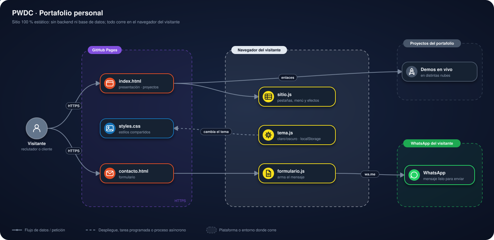

# Portafolio · Luis F. A.

<p>
  <a href="https://lariasca1994.github.io/PWDC/"></a>
</p>


> 📘 **[Manual de usuario](docs/MANUAL.md)**: cómo recorrer el sitio y escribirme, con imágenes.

## Contenido

1. [Presentación](#1-presentación)
2. [Funcionalidades](#2-funcionalidades)
3. [Arquitectura](#3-arquitectura)
4. [Estructura del proyecto](#4-estructura-del-proyecto)
5. [Instalación para pruebas](#5-instalación-para-pruebas)
6. [Autor y licencia](#6-autor-y-licencia)

---

## 1. Presentación

Sitio personal estático (HTML, CSS y JavaScript, sin frameworks ni servidor): presentación
profesional, los proyectos del portafolio con enlace a sus demos y un formulario de contacto. Está
orientado a QA y validación de API REST, soporte y gestión de incidentes, y análisis y calidad de
datos.

**Sitio:** [lariasca1994.github.io/PWDC](https://lariasca1994.github.io/PWDC/)

## 2. Funcionalidades

- Presentación, servicios, proyectos (con filtros por área), forma de trabajo y habilidades.
- Formulario de contacto que arma el mensaje y abre WhatsApp: no envía datos a ningún servidor.
- Tema claro y oscuro recordado en el navegador, animaciones suaves y diseño adaptable a celular,
  tablet y computador; se instala como aplicación.

## 3. Arquitectura

<p align="center">
  
</p>

## 4. Estructura del proyecto

```
index.html        Página principal: presentación, servicios, proyectos y habilidades
contacto.html     Formulario de contacto
CSS/styles.css    Estilos y tema claro/oscuro
JS/sitio.js       Menú, filtros de proyectos y efectos
JS/tema.js        Tema claro/oscuro
JS/formulario.js  Arma el mensaje y abre WhatsApp
docs/             Manual de usuario y diagramas
```

## 5. Instalación para pruebas

No necesita instalación: abre `index.html` en el navegador o sírvelo en local con `npm start`.

## 6. Autor y licencia

**Luis F. A.** · [GitHub](https://github.com/lariasca1994) · [LinkedIn](https://linkedin.com/in/lfac1)

Contacto: Telegram [@lfac6](https://t.me/lfac6) · WhatsApp [@carraian160](https://wa.me/carraian160) ·
[ariascluisf@hotmail.com](mailto:ariascluisf@hotmail.com)

Licencia: MIT.
