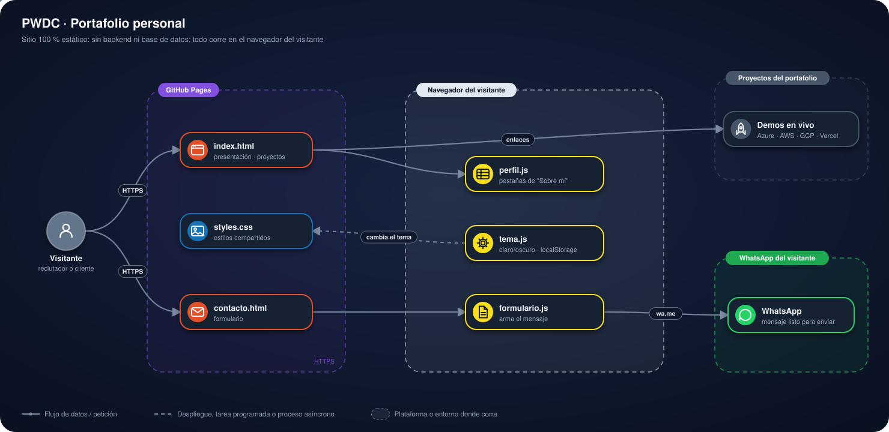

# Portafolio — Luis Felipe Arias

<p>
  <a href="https://lariasca1994.github.io/PWDC/"></a>
</p>


## Contenido

1. [Presentación](#1-presentación)
2. [Estructura del proyecto](#2-estructura-del-proyecto)
3. [Arquitectura](#3-arquitectura)
4. [Plataformas y su función](#4-plataformas-y-su-función)
5. [Cómo usar la plataforma](#5-cómo-usar-la-plataforma)
6. [Instalación para pruebas](#6-instalación-para-pruebas)
7. [Autor y licencia](#7-autor-y-licencia)

---

## 1. Presentación

Sitio personal, estático (HTML, CSS y JavaScript puro, sin frameworks ni
backend): presentación profesional, proyectos desplegados del portafolio y
un formulario de contacto real.

### En pocas palabras

- **Qué es:** mi carta de presentación en la web. Cuenta a qué me dedico,
  muestra los proyectos con enlace a sus demos y ofrece un formulario para
  escribirme.
- **Cómo verlo:** entra al [sitio](https://lariasca1994.github.io/PWDC/), o
  descarga el repositorio y abre `index.html` en tu navegador; no necesita
  instalar nada (ver [Instalación para pruebas](#6-instalación-para-pruebas)).

### Demo en vivo

**Sitio:** [lariasca1994.github.io/PWDC](https://lariasca1994.github.io/PWDC/)

### Enfoque

El sitio está orientado a los perfiles a los que apunto: QA / Pruebas
funcionales y validación de API REST, Soporte y Gestión de Incidentes (ITIL),
y Análisis y Calidad de Datos. La sección "Sobre mí" está organizada en
pestañas por esos tres perfiles, y cada proyecto listado indica su stack y
enlaza a una demo en vivo cuando está desplegado.

---

## 2. Estructura del proyecto

```
├── index.html          # página principal: presentación, proyectos, habilidades
├── contacto.html        # formulario de contacto
├── CSS/styles.css        # tema claro/oscuro, estilos de todo el sitio
└── JS/
    ├── perfil.js          # pestañas de la sección "Sobre mí"
    ├── tema.js             # alternador de tema claro/oscuro (localStorage)
    ├── formulario.js        # abre WhatsApp con el mensaje del formulario ya escrito
    └── animaciones.js       # entrada al hacer scroll y foco de luz en las tarjetas
```

---

## 3. Arquitectura

<p align="center">
  
</p>

- En el **navegador del visitante** corren tres scripts: las pestañas de
  "Sobre mí", el cambio de tema claro/oscuro (recordado en `localStorage`) y el
  formulario de contacto.
- El formulario no envía datos a ningún servidor: arma el mensaje y abre
  **WhatsApp** con el texto ya escrito; el visitante decide si lo envía.

---

## 4. Plataformas y su función

| Plataforma | Función en el proyecto |
|---|---|
|  | Sirve los archivos estáticos por HTTPS. |

No se conecta a nada más: no requiere base de datos, backend ni API keys.

---

## 5. Cómo usar la plataforma

El sitio es público: no pide cuenta ni inicio de sesión.

### 5.1 Recorrer el sitio

1. Entra al [sitio](https://lariasca1994.github.io/PWDC/).
2. **Sobre mí:** cambia entre las pestañas de los tres perfiles (QA, soporte y datos).
3. **Proyectos y Repositorios:** cada tarjeta indica el stack del proyecto y ofrece
   **Ver demo →**, con el color de cada proyecto.
4. **Habilidades técnicas:** agrupadas en QA y soporte, desarrollo y datos, y cloud.
5. El botón de tema alterna entre modo claro y oscuro, y el sitio recuerda tu elección.

### 5.2 Escribirme

1. Abre **Contacto**.
2. Completa **Nombre**, **Mensaje** y, si quieres, **¿Cómo te contacto?**.
3. Pulsa **Enviar por WhatsApp**: se abre WhatsApp con el mensaje listo para enviar.
   También puedes escribir directo por WhatsApp o Telegram a **@cortosvar26**.

---

## 6. Instalación para pruebas

No necesita instalación. Basta con abrir `index.html` en el navegador, o
servirlo en local:

```bash
npm start
```

(usa `npx serve` para levantarlo en `http://localhost:8200`).

### Publicación

Para publicarlo: Settings → Pages → Branch: main → Save, en GitHub. Da una
URL pública en un par de minutos — la que está en uso hoy es
`https://lariasca1994.github.io/PWDC/`.

---

## 7. Autor y licencia

> 📘 **[Manual de usuario](docs/MANUAL.md)**: cómo usar el sitio campo por campo, qué datos se ingresan y qué garantiza en seguridad.

**Luis Felipe Arias Carriazo**
[GitHub](https://github.com/lariasca1994) · [LinkedIn](https://linkedin.com/in/lfac1)

Licencia: MIT.
