# 📘 Manual de usuario · Portafolio de Luis F. A. (PWDC)

## 1. Portada

| | |
|---|---|
| **Producto** | Portafolio profesional de Luis F. A. (PWDC) |
| **Documento** | Manual de usuario |
| **Versión** | 2.0 · noviembre de 2026 |
| **Dirigido a** | Reclutadores, clientes y cualquier persona que visite el portafolio |
| **Dirección** | [Portafolio](https://lariasca1994.github.io/PWDC/) |
| **Autor** | Luis F. A. |

## Contenido

1. [Portada](#1-portada)
2. [Introducción](#2-introducción)
3. [Objetivo](#3-objetivo)
4. [Alcance](#4-alcance)
5. [Acceso al sistema](#5-acceso-al-sistema)
6. [Pantalla principal](#6-pantalla-principal)
7. [Navegación](#7-navegación)
8. [Funcionalidades](#8-funcionalidades)
9. [Gestión de perfil](#9-gestión-de-perfil)
10. [Mensajes frecuentes](#10-mensajes-frecuentes)
11. [Preguntas frecuentes](#11-preguntas-frecuentes)
12. [Glosario](#12-glosario)

---

## 2. Introducción

El **portafolio** presenta mi perfil profesional en QA, soporte TI y cloud: los servicios que
ofrezco, los proyectos en producción con enlace a sus demos, cómo trabajo y mis habilidades. Desde
**Contacto** puedes escribirme.

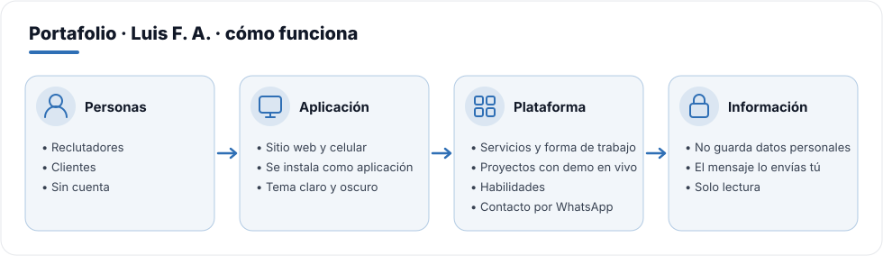

## 3. Objetivo

Que cualquier persona conozca mi experiencia, pruebe los proyectos en vivo y me contacte fácilmente.

## 4. Alcance

**Incluye:** presentación, servicios, proyectos con filtros por área, forma de trabajo,
habilidades, formulario de contacto y uso en celular, tablet y computador.

**No incluye:** cuentas de usuario ni almacenamiento de datos: el sitio solo muestra información.

**Qué necesitas:** un navegador y conexión a internet.

## 5. Acceso al sistema

No necesitas cuenta: el sitio es público. Abre la
[dirección del portafolio](https://lariasca1994.github.io/PWDC/).

## 6. Pantalla principal

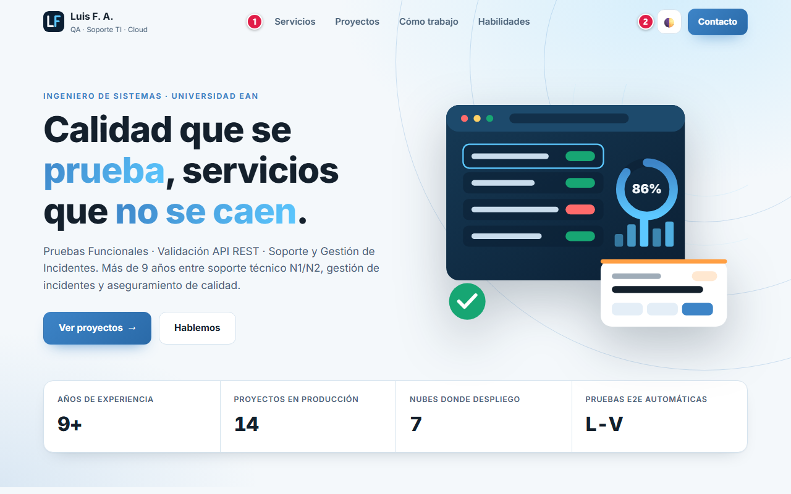

| # | Elemento | Qué hace |
|:-:|---|---|
| 1 | Menú | Lleva a Servicios, Proyectos, Cómo trabajo y Habilidades |
| 2 | Tema | Cambia entre claro y oscuro; el sitio lo recuerda |

**Ver proyectos** baja a la lista de proyectos y **Hablemos** abre el formulario de contacto.

## 7. Navegación

En la tablet y en el celular el menú pasa a una barra inferior con Inicio, Perfil, Proyectos,
Habilidades y Contacto.

| Tablet en vertical | Celular |
|:-:|:-:|
| 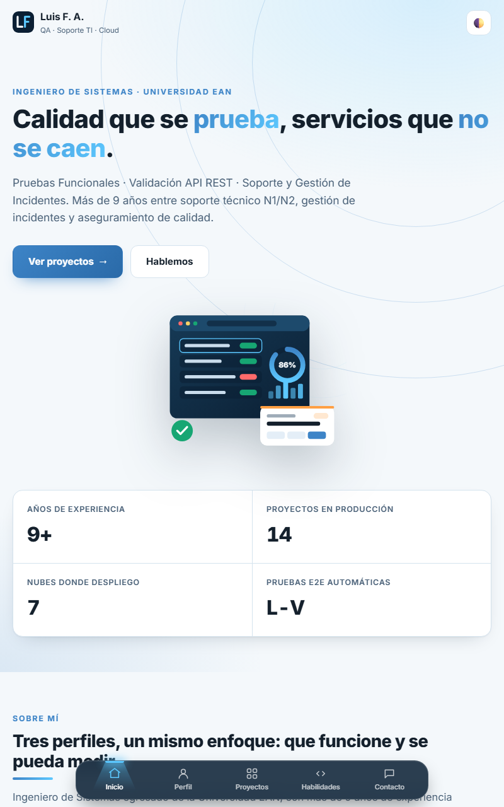 | 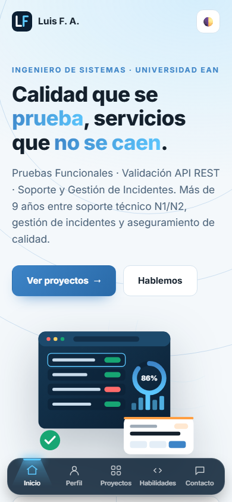 |

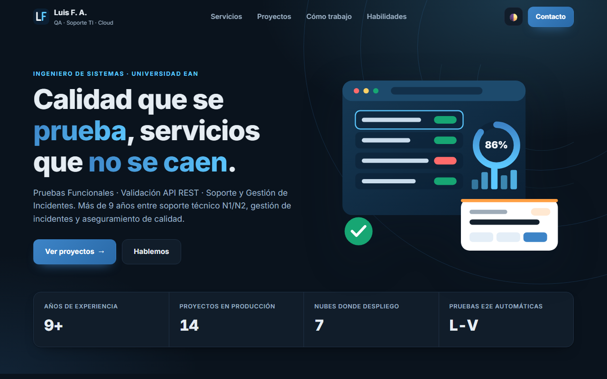

## 8. Funcionalidades

### 8.1 Crear: escribirme

En **Contacto** completa el formulario:

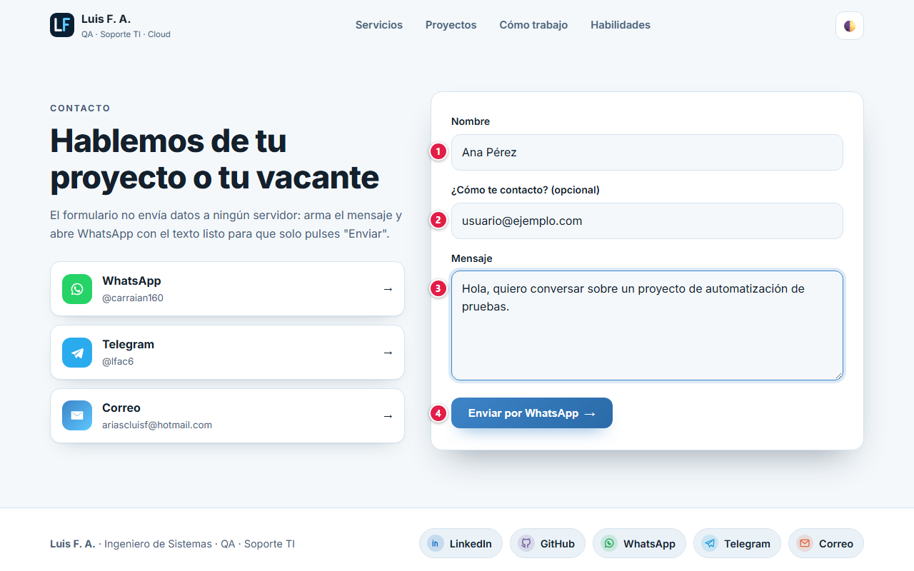

| # | Campo | Qué escribir |
|:-:|---|---|
| 1 | Nombre | Tu nombre |
| 2 | ¿Cómo te contacto? | Opcional: tu correo o teléfono |
| 3 | Mensaje | Lo que necesitas |
| 4 | Enviar por WhatsApp | Abre WhatsApp con el mensaje listo; tú decides si lo envías |

El formulario no envía datos a ningún servidor. También puedes escribirme directamente por WhatsApp,
Telegram o correo desde los botones de la misma página.

### 8.2 Consultar: proyectos, servicios y habilidades

**Proyectos y repositorios:** cada tarjeta resume el proyecto y su tecnología, y **Ver demo**
abre la aplicación en vivo. Los filtros muestran solo QA y pruebas, Operación TI, Datos y
automatización o Aplicaciones web.

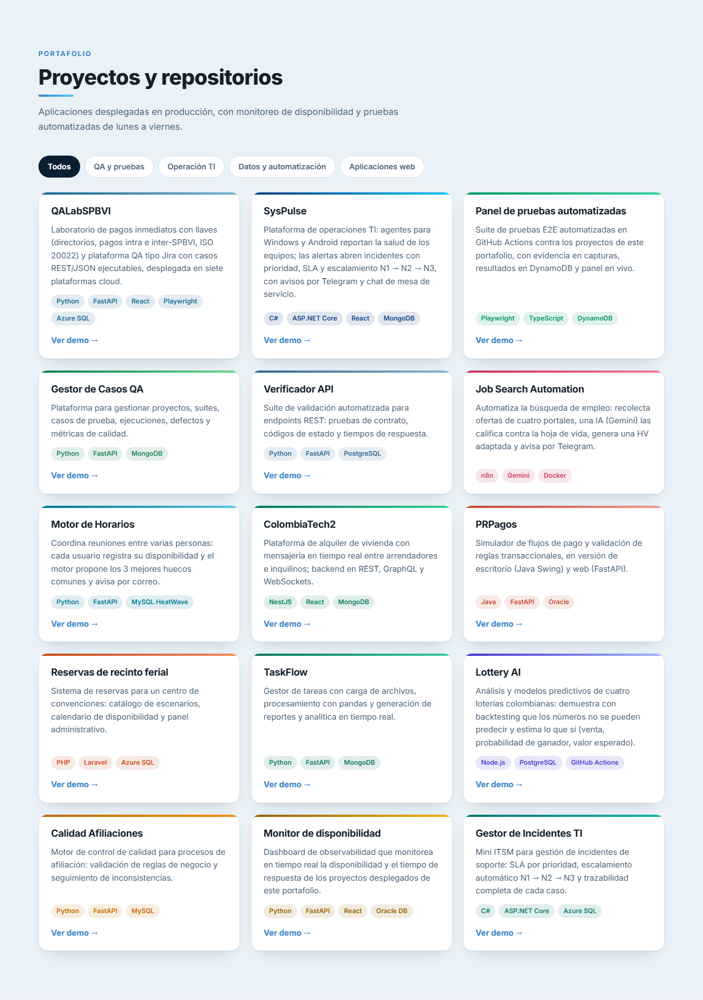

**Servicios** y **Habilidades** describen lo que hago y las herramientas que uso:

| Servicios | Habilidades |
|:-:|:-:|
| 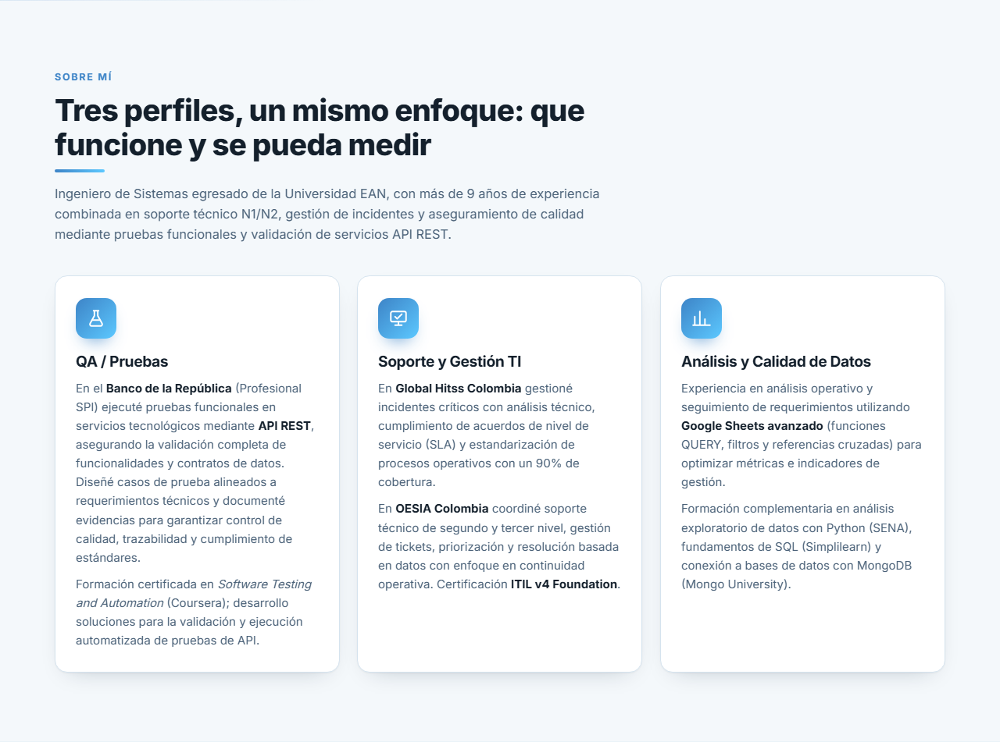 | 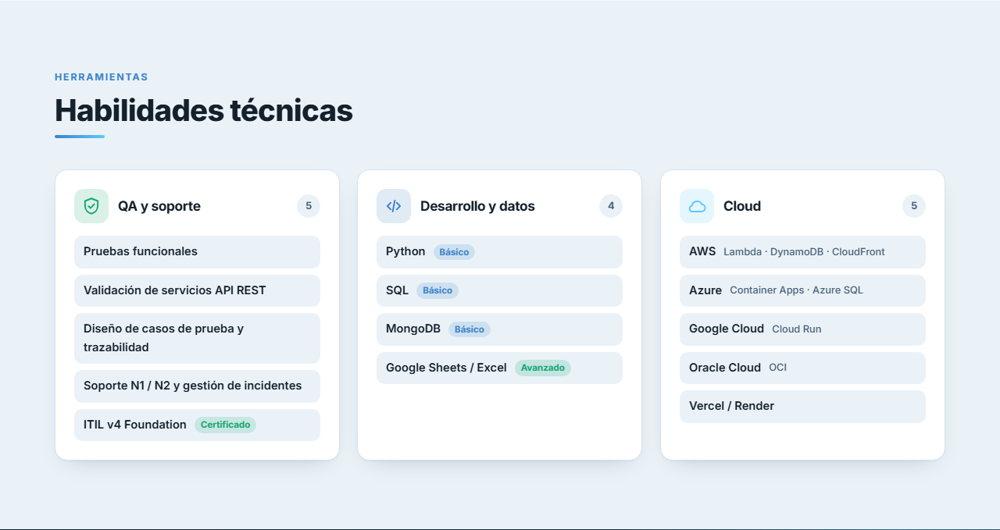 |

### 8.3 Modificar

No aplica: el sitio solo muestra información.

### 8.4 Reportar

No aplica. Cada proyecto tiene su propio monitoreo de disponibilidad y sus pruebas automatizadas,
enlazados desde su README.

## 9. Gestión de perfil

No aplica: el sitio no tiene cuentas. El tema claro u oscuro se recuerda en tu navegador.

## 10. Mensajes frecuentes

| Mensaje | Qué significa | Qué hacer |
|---|---|---|
| Esta dirección no responde | La dirección no existe | Usa **Ir al inicio** |
| Sin conexión | Tu equipo no tiene internet | La pantalla reintenta sola |

| Página no encontrada | Sin conexión |
|:-:|:-:|
| 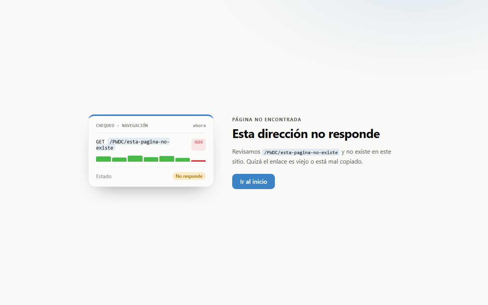 | 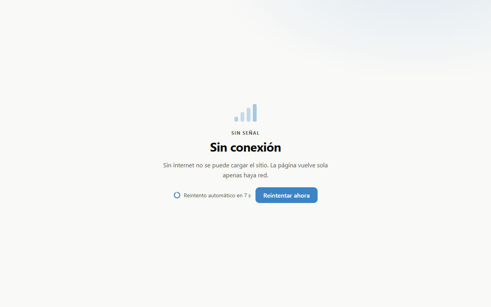 |

## 11. Preguntas frecuentes

**¿Por qué una demo tarda en abrir?** Varios proyectos se suspenden cuando nadie los usa y tardan
un momento en despertar.

**¿El formulario guarda mis datos?** No: solo arma el mensaje y abre WhatsApp.

**¿Se puede instalar como aplicación?** Sí: en Chrome o Edge, **Instalar aplicación**; en iPhone,
Safari → **Compartir → Agregar a inicio**.

**¿Cómo te contacto?** Telegram [@lfac6](https://t.me/lfac6), WhatsApp
[@carraian160](https://wa.me/carraian160) o [ariascluisf@hotmail.com](mailto:ariascluisf@hotmail.com).

## 12. Glosario

| Término | Qué significa |
|---|---|
| **Demo** | La aplicación funcionando en internet, para probarla |
| **QA** | Aseguramiento de calidad: probar que el software funciona como debe |
| **Repositorio** | Donde se guarda el código de un proyecto |
| **Soporte TI** | Atención de incidentes y mantenimiento de los sistemas |
