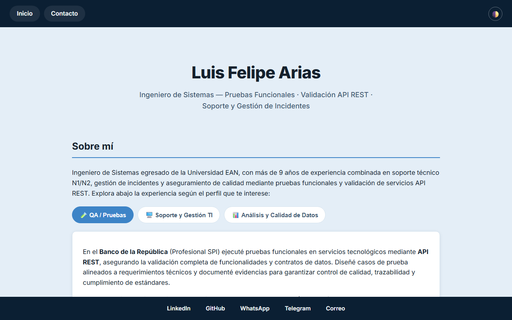
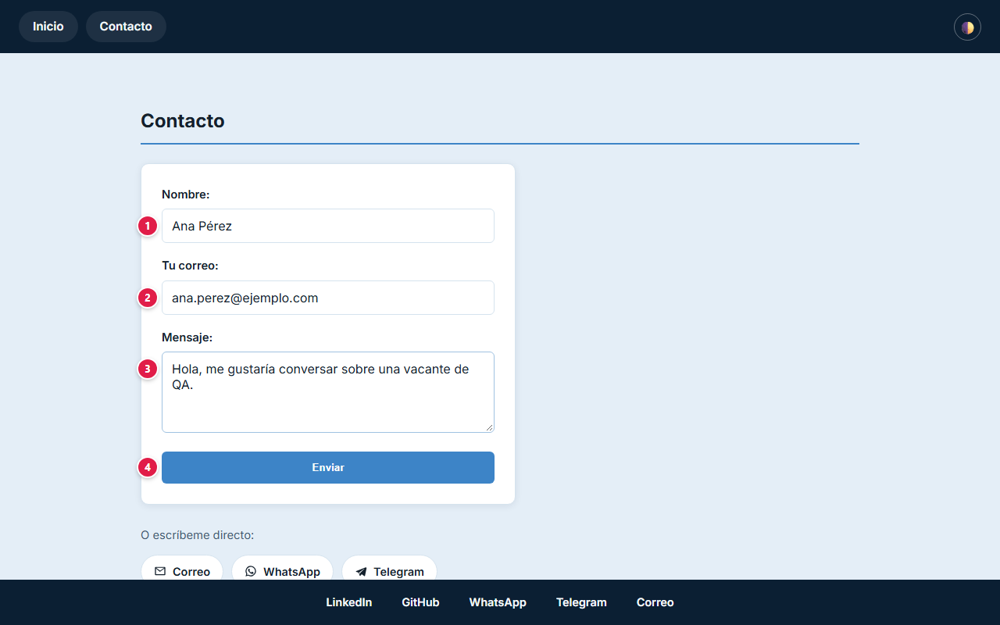

# 📘 Manual de usuario · PWDC

Guía del sitio de portafolio: qué contiene, cómo funciona el formulario de contacto y qué datos
maneja. Para la parte técnica vuelve al [README](../README.md).

**Sitio:** [lariasca1994.github.io/PWDC](https://lariasca1994.github.io/PWDC/)

## Contenido

1. [En pocas palabras](#1-en-pocas-palabras)
2. [Paso a paso](#2-paso-a-paso)
3. [Qué información se maneja y dónde queda](#3-qué-información-se-maneja-y-dónde-queda)
4. [Seguridad: qué se garantiza](#4-seguridad-qué-se-garantiza)

---

## 1. En pocas palabras

Sitio de portafolio personal hecho con HTML, CSS y JavaScript puro, publicado en GitHub Pages. No
tiene servidor, base de datos ni cuentas.

## 2. Paso a paso

### 2.1 Inicio

Presenta el perfil y los proyectos. El botón de tema alterna entre claro y oscuro y recuerda tu
elección en este navegador.

### 2.2 Contacto

| # | Campo | Qué escribir |
|:-:|---|---|
| 1 | Nombre | Tu nombre |
| 2 | Correo | Tu correo, para poder responderte |
| 3 | Mensaje | Lo que quieres decir |
| 4 | Enviar | Abre **tu propio programa de correo** con el mensaje ya escrito; solo falta pulsar Enviar ahí |

Los tres campos son obligatorios.

## 3. Qué información se maneja y dónde queda

| Dato | Dónde queda |
|---|---|
| Nombre, correo y mensaje del formulario | **En ningún servidor.** El sitio arma un enlace `mailto:` y tu programa de correo envía el mensaje; el sitio no lo guarda ni lo transmite |
| Preferencia de tema | `localStorage` de tu navegador |

## 4. Seguridad: qué se garantiza

Comprobado en el código (`JS/formulario.js`, `JS/tema.js`):

- **Sin recolección de datos:** no hay backend, base de datos, cookies de seguimiento ni servicios
  de terceros para el formulario.
- **Tú controlas el envío:** el mensaje sale desde tu propio correo y puedes revisarlo antes de
  enviarlo.
- **HTTPS** provisto por GitHub Pages.
